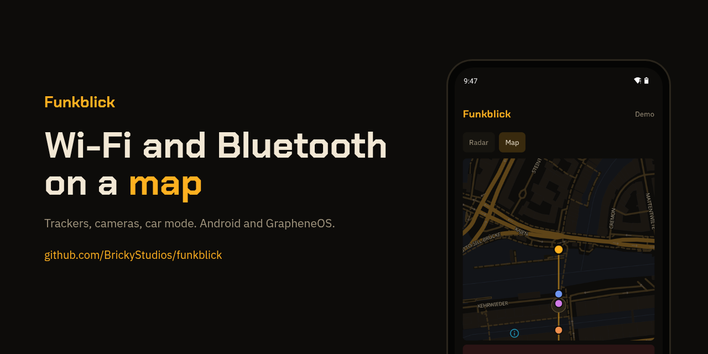
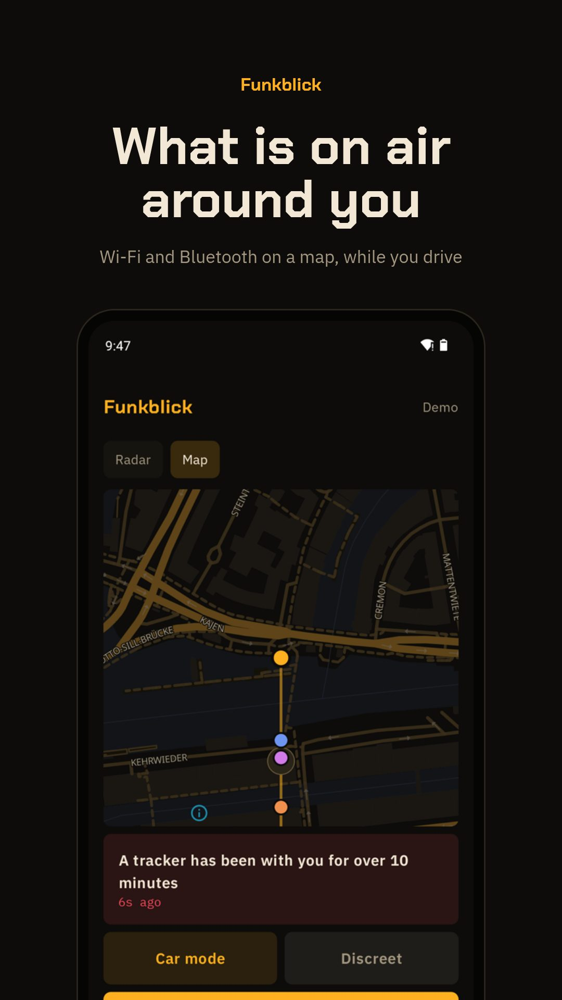
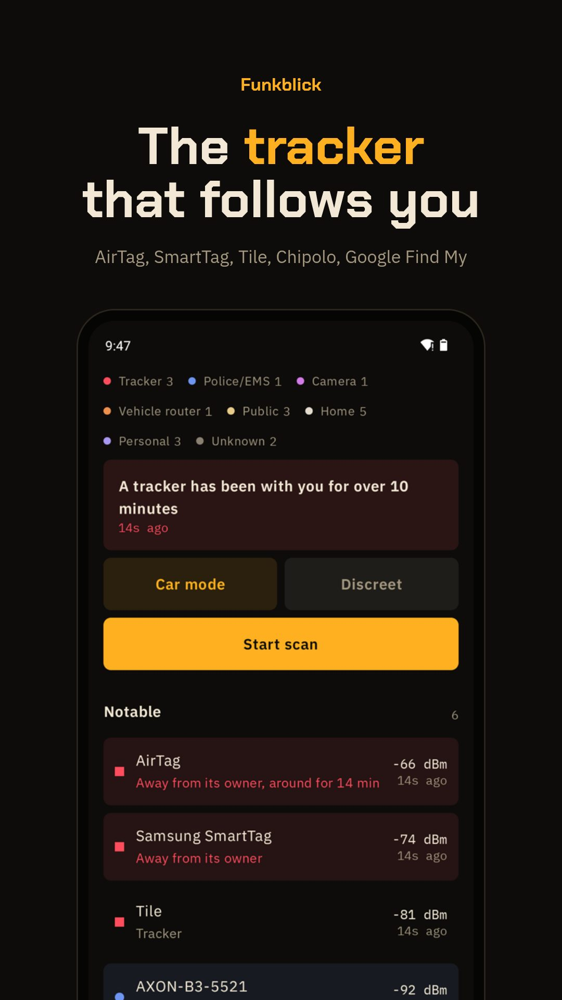
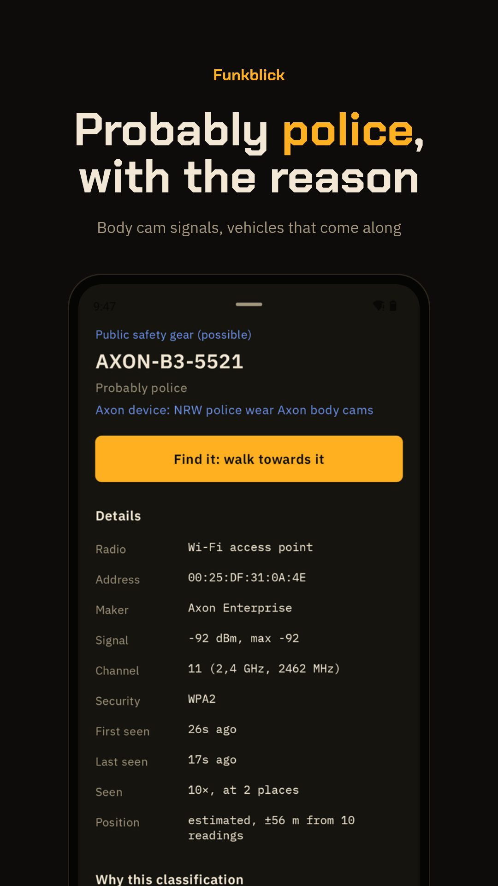
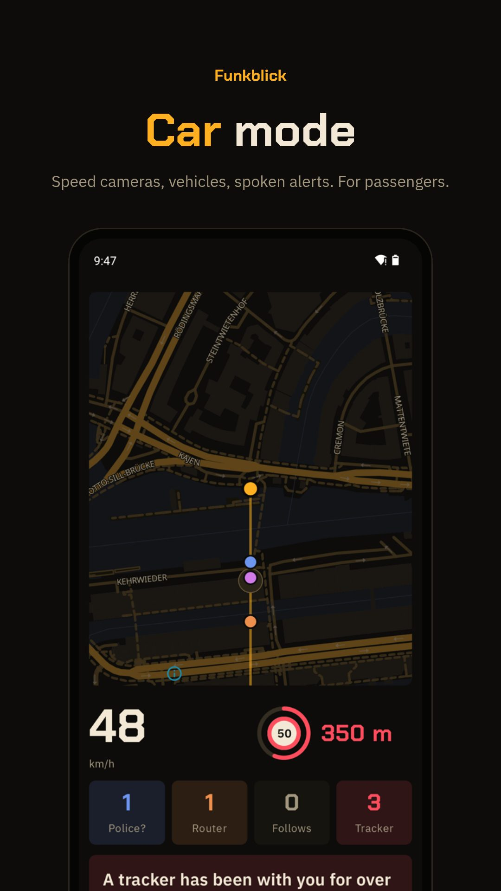
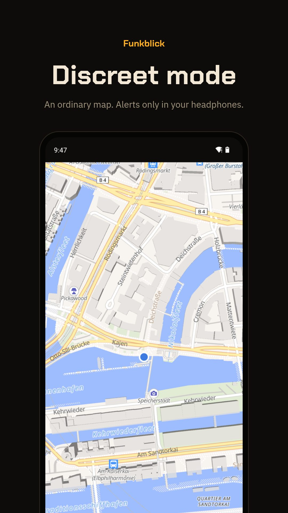

<p align="center"></p>

<h1 align="center">Funkblick: Wi-Fi and Bluetooth scanner for Android with tracker alerts, hidden camera finder and car mode</h1>

<p align="center"><strong>Passive Wi-Fi and BLE radar for Android and GrapheneOS. Shows every network and Bluetooth device your phone can hear, looks up the maker, warns when an AirTag or other tracker follows you or a camera runs its own Wi-Fi, and has a car mode with spoken alerts. No root, no account, English and German.</strong></p>

<p align="center">
  <a href="https://kotlinlang.org/"></a>
  <br>
  <a href="#install"></a>
  <a href="#install"></a>
  <a href="https://developer.android.com/compose"></a>
  <a href="#tracker-protection"></a>
  <a href="#what-it-does"></a>
  <a href="#privacy"></a>
  <a href="https://github.com/BrickyStudios/funkblick/actions/workflows/ci.yml"></a>
  <a href="LICENSE"></a>
  <a href="https://github.com/BrickyStudios/funkblick/commits/main"></a>
</p>

<p align="center">
  <a href="https://github.com/BrickyStudios/funkblick/releases/latest/download/Funkblick.apk"></a>
  <a href="https://brickystudios.github.io/funkblick/"></a>
</p>

<p align="center">
  <a href="#install">Install</a> ·
  <a href="#what-it-does">What it does</a> ·
  <a href="#car-mode-and-the-law">Car mode</a> ·
  <a href="#what-it-cant-do">Limits</a> ·
  <a href="#build-it-yourself">Build</a> ·
  <a href="#auf-deutsch">Deutsch</a>
</p>

Your phone hears dozens of radios all the time: routers, hotspots, earbuds, watches, cars, cameras. Android keeps that to itself. Funkblick puts it on a radar, looks up who built each device in the IEEE registry, reads what Bluetooth devices broadcast about themselves, and tells you why it put something in a category. When something deserves attention it plays its own sound and says what it is.

It started as an open-source answer to [SØPHIA Android](https://brickystudios.github.io/funkblick/sophia-alternative/), a paid scanner sold on Gumroad, and grew a few things that matter in Germany: tracker protection, cameras in holiday flats, Wi-Fi channels by EU rules, and a car mode that is honest about § 23 StVO.

<p align="center">
  
  
  
</p>
<p align="center">
  
  
</p>
<p align="center"><sub>Screenshots from the built-in demo with invented surroundings.</sub></p>

## Install

1. Download [Funkblick.apk](https://github.com/BrickyStudios/funkblick/releases/latest/download/Funkblick.apk) on your phone and open it. Allow installs from your browser if Android asks.
2. Open Funkblick, tap **Start scan**, allow location and nearby devices. Android only hands out Wi-Fi results to apps with location permission.
3. To look around before scanning, tap **open the demo**.

Android 8.0 or newer on a 64-bit ARM phone. No Google Play services needed, so it runs on GrapheneOS, CalyxOS, LineageOS and Huawei phones. Funkblick checks GitHub Releases on start and installs new versions with one tap. [Obtainium](https://github.com/ImranR98/Obtainium) works too.

## What it does

| | |
|---|---|
| **Radar** | Every Wi-Fi access point and Bluetooth LE device in range. Distance from the centre is signal strength, circle = Wi-Fi, square = Bluetooth, colour = kind. |
| **Maker lookup** | 54,000 prefixes from the IEEE registry (MA-L /24, MA-M /28, MA-S /36, longest wins), plus Bluetooth company ids. Random addresses are marked as random instead of guessed. |
| **Categories** | Tracker, possible public safety gear, camera, vehicle/cellular router, car (infotainment Wi-Fi like "My VW 1013" or "Audi_MMI"), public Wi-Fi, business network, home router, phone/watch/headphones, unknown. Each with the evidence behind it: registry, maker signature, payload, name, your rule. |
| **Map** | OpenStreetMap vector map (OpenFreeMap, MapLibre) in the night palette: your track, fixed speed cameras, alerts and where fixed devices probably are, estimated from signal strength along the way. Bundled into numbers until you zoom into a street. The area around you can be saved for offline use. |
| **Probably police** | Evidence instead of a hunch: Axon gear over Bluetooth (NRW police wear Axon body cams), a vehicle that comes along while public safety gear is in range, a following Ford or Mercedes in NRW (the patrol fleet) as "possible". Vehicles, routers and tags seen on an earlier day are recognised ("seen before on 08.11."). |
| **Discreet mode** | A light, ordinary-looking map with only your position. No radar, no colours, notifications say only "Funkblick", alerts come through headphones. Tap three times to leave. |
| **Rules** | Watch or mute by address, maker prefix, exact name, name contains, maker contains. Mute always wins. Stored on the phone. |
| **Alerts** | Own signal per kind plus a spoken line (Piper TTS, English and German). Only fresh sightings ring, cached scan results never do, 5 minutes cooldown per device. Music ducks like it does for navigation. |
| **Setup check** | On start, a checklist of every permission and switch the scan needs (location, nearby devices, notifications, Wi-Fi, Bluetooth, battery optimization), each with a button that opens the right Android screen. |
| **Find mode** | Pick a tracker or camera and walk towards it: big smoothed signal meter, warmer/colder, a beep that speeds up as you get closer. |
| **Car start** | Quick settings tile to start or stop scanning. Optional: when the phone connects to a car's Bluetooth, one tap on the notification opens car mode. |
| **Logs and export** | Every session as JSON on the phone, written every minute, copied to Downloads with one tap. Export CSV, JSON, GPX (opens in Organic Maps), GeoJSON or an AI debrief to paste into ChatGPT, Claude or a local model. |
| **Diagnostics** | Wi-Fi scans requested and throttled, BLE state and adverts, GPS fixes, sounds played, build id. |

### Tracker protection

AirTag and other Apple Find My accessories, Samsung SmartTag, Tile, Chipolo, Pebblebee and tags in Google's Find My network. Funkblick reads the payload, so it can tell a tag next to its owner from one on its own, and warns when a separated tag has been with you for ten minutes without a five-minute gap. With GPS it also has to come along to three places at least 300 m apart, like AirGuard does, so a lost tag next door or a stranger's bag on the train stays quiet. Find mode then leads you to it. Formats as documented by the [AirGuard](https://github.com/seemoo-lab/AirGuard) research project at TU Darmstadt. The More page has German help numbers: police 110, violence-against-women helpline 116 016, Weisser Ring 116 006.

### Hidden cameras

Camera makers (Hikvision, Dahua, EZVIZ, Axis, Ring, Arlo, Wyze, Reolink, Mobotix …) and Wi-Fi names cameras use when they open their own network (V380, IPC, LookCam, HDLiveCam …).

### Channel tips

Counts the networks per channel, weighs them by signal and suggests the quietest 2.4 GHz channel out of 1, 6, 11 and 13 (EU) and the quietest 5 GHz channel, preferring channels without DFS.

## Car mode and the law

Full screen: the map on two thirds, below it big speed, distance to the next fixed speed camera with its limit, counters for vehicle routers, possible public safety gear, trackers and cameras, the last alerts, screen stays on. Speed cameras are 5,192 fixed cameras in Germany from OpenStreetMap, bundled in the app, so your position never leaves the phone. A button refreshes them for your region; that sends a box of about 130 km around you to OpenStreetMap's Overpass server and nothing else. A button opens the official Blitzer.de app for mobile cameras.

Car mode also counts vehicles that come along: a car's Wi-Fi seen at three places over four minutes gets reported as "a vehicle has been with you for minutes". Your own car is recognised by being there from the start with a strong signal and never counts. This came out of the first test drives, where a "My VW" hotspot stayed behind us for six minutes.

All of this is **off by default**. Turning it on shows a warning first: German law (§ 23 Abs. 1c StVO) forbids drivers to use functions that point out traffic enforcement, 75 € and a point, also when a passenger's phone warns for the driver. Switzerland bans speed camera warnings altogether. Funkblick is meant for the passenger seat.

"Possible public safety gear" means a body cam or vehicle maker (Axon, Motorola Solutions, WatchGuard, Getac …) showed up in Wi-Fi or Bluetooth. Vehicle routers (Cradlepoint, Sierra Wireless, Teltonika, Inseego …) sit in police cars, but also in buses, ambulances and delivery vans. A maker match only tells you who built the hardware.

### Sound in the car, Android Auto

Alerts play as navigation prompts, so music ducks and they take the same route as your navigation voice. With Android Auto connected they come out of the car speakers. Over plain Bluetooth the car has to be on its Bluetooth or phone audio source; while it plays its own radio, many cars (BMW included) drop phone audio.

Funkblick does not show up on the Android Auto screen yet. Android Auto only runs car apps installed from Google Play, and a GitHub APK would need workarounds like UnknownAuto. Until then: phone in a mount, car mode open, screen stays on.

## What it can't do

- **No direction.** A phone measures signal strength, not direction. The angle on the radar is just a stable spot per device.
- **Access points only.** Android lists routers and hotspots, not devices that are merely connected to one. A camera on the host's home network is invisible to any app.
- **No police radio.** Police and EMS use TETRA (Germany) or P25 (US). No phone can receive that.
- **Android throttles Wi-Fi scans** to 4 per 2 minutes. Funkblick asks every 10 seconds, which pays off once you switch off "Wi-Fi scan throttling" in the developer options. With the screen off, Android pauses unfiltered Bluetooth scans, so Funkblick then only listens for trackers and watched addresses.
- **No beeping trackers.** Making a tag play a sound needs a Bluetooth connection, and Funkblick never connects to anything.

## Roadmap

Done in 1.1 to 1.4: find mode, the tracker rule with places, quick settings tile and car start, speed camera refresh, the setup checklist, logs to Downloads, the car category, vehicles that follow you, the map with device positions, probably police, discreet mode, GPX/GeoJSON, a calmer design with three tabs.

Next:
1. **Web viewer** on the website: open a shared log in any browser, iPhone included (map, list, AI debrief). Scanning itself can't work on iPhones: iOS lets neither websites nor apps scan Wi-Fi, and Safari has no Web Bluetooth.
2. **Trip review** with a timeline after each drive.
3. **Android Auto** screen, once there is a way that does not depend on Google Play.

## Privacy

Scans, rules, logs and positions stay on the phone. The only network request is the update check against the GitHub Releases API. Safe mode, on by default, shortens addresses in exports and logs to the maker part plus a hash, hides the names of home networks and phones, and rounds positions to about a kilometre. A second switch does the same on screen, for screenshots.

## Build it yourself

```sh
./gradlew testDebugUnitTest assembleDebug    # JDK 17, Android SDK 35
```

The classification logic in `core/` has no Android types and is covered by unit tests: tracker payloads, registry lookups, categories, rules, alert freshness and cooldown, the 10-minute rule, channel tips, CSV/JSON escaping, speed camera distance and heading.

Data files are generated, not hand-written:

| File | Script | Source |
|---|---|---|
| `app/src/main/assets/oui.txt` | `tools/build_oui.py` | IEEE Registration Authority (MA-L, MA-M, MA-S) |
| `app/src/main/assets/speedcams.tsv` | `tools/build_speedcams.py` | OpenStreetMap via Overpass, ODbL |
| `app/src/main/assets/sounds/` | `tools/build_sounds.py` | synthesized tones, Piper TTS voices Thorsten (CC0) and LJ Speech (public domain) |
| `docs/` (website) | `tools/build_site.py` | |
| `docs/bilder/` | `tools/promo.mjs` | screenshots of the demo mode |

Releases: push a tag `v*`, GitHub Actions runs the tests, signs the APK and attaches it as `Funkblick.apk`.

## Auf Deutsch

Funkblick ist ein WLAN- und Bluetooth-Scanner fürs Android-Handy, auch für GrapheneOS. Die App zeigt jedes Netz und jedes Gerät in Reichweite auf einem Radar, nennt den Hersteller und erklärt ihre Einordnung. Sie warnt, wenn dir ein AirTag oder anderer Tracker folgt oder eine Kamera ein eigenes WLAN aufmacht, und empfiehlt den freiesten WLAN-Kanal für die FRITZ!Box. Der Auto-Modus mit festen Blitzern aus OpenStreetMap und Ansagen ist standardmäßig aus und nur für Beifahrer gedacht (§ 23 Abs. 1c StVO). Die App spricht Deutsch, wenn das Handy auf Deutsch steht.

Mehr auf der [deutschen Website](https://brickystudios.github.io/funkblick/de/): [AirTag finden mit Android](https://brickystudios.github.io/funkblick/de/airtag-finden-android/) · [Versteckte Kamera finden](https://brickystudios.github.io/funkblick/de/versteckte-kamera-finden/) · [WLAN-Kanal für die FRITZ!Box](https://brickystudios.github.io/funkblick/de/wlan-kanal-fritzbox/) · [Blitzer-App für Beifahrer](https://brickystudios.github.io/funkblick/de/blitzer-app-beifahrer/)

## License

GPL-3.0. Maker data © IEEE, speed cameras © OpenStreetMap contributors (ODbL), fonts Chakra Petch and IBM Plex Mono (OFL). Not affiliated with Apple, Google, Samsung, Blitzer.de or SØPHIA.
